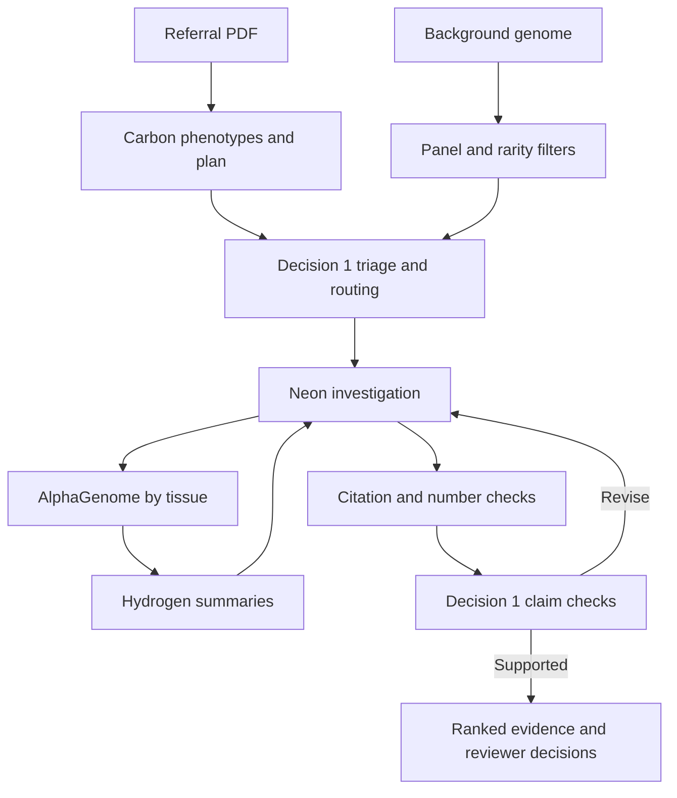

# GeneSleuth

An AI detective that helps geneticists find the hidden cause of unsolved genetic disease.

A child with epileptic encephalopathy had two rounds of blood RNA sequencing with ambiguous results. A deep intronic DNM1 variant affected an exon used in brain-specific transcripts. AlphaGenome predicted an effect in glutamatergic neurons and little corresponding signal in venous blood. Splice predictors can flag a variant. The tissue comparison helps explain why the blood tests were inconclusive. This published case motivates GeneSleuth and is excluded from the evidence for generalization. [AlphaGenome Atlas paper, Fig. 3](https://storage.googleapis.com/deepmind-media/DeepMind.com/Blog/alphagenome-atlas-a-predictive-map-of-every-possible-dna-letter-change-in-the-human-genome/alphagenome-atlas.pdf)

## The problem

Many families remain without a diagnosis after genetic testing. Protein-coding sequence accounts for roughly 2% of the genome, and the remaining sequence includes variants that can alter splicing and regulation. Finding a relevant variant takes more than looking for the largest predicted change. The candidate has to fit the patient's symptoms, the gene, and the tissue where the effect matters. [Genome Sequencing for Diagnosing Rare Diseases](https://doi.org/10.1056/NEJMoa2314761) · [AlphaGenome overview](https://deepmind.google/blog/alphagenome-ai-for-better-understanding-the-genome/)

## Built today at the Gemini 4 NYC Hackathon (Nov 21, 2026)

The five research briefs in `docs/research/` are planning documents written on Nov 19, before the event. All code in this repository, and all data files generated from public sources, were written or produced on Nov 21. Nothing was copied from an earlier project. Everything below was built during the event, by component.

- **Data (`genesleuth/data`, `scripts/data_*.py`, `assets/`):** streaming of the 1000 Genomes NA12878 background for 58 epilepsy genes, a gnomAD v4.1 rarity filter (12,923 variants in the panel regions, 282 suspects after the filter and the planted variant), MANE-based region annotation, case construction that plants a real ClinVar variant, and a committed 21 MB data bundle with a one-command setup check.
- **Lookups (`genesleuth/lookups`):** region context, population frequency, gene and phenotype lookups, HPO matching and a ClinVar lookup that is switched off during every run.
- **Cases and letters (`genesleuth/data/letters.py`):** 126 synthetic referral letters written by Gemini 4 Hydrogen from sampled HPO terms, rendered as PDFs, many as noisy scans. A regex check rejects any letter that names the gene, the variant or the condition.
- **Agent (`genesleuth/agent`, `genesleuth/checker`, `genesleuth/*_client.py`):** Carbon reads the letter, Decision 1 triages 282 suspects in about two seconds and fact-checks claims, Neon investigates with native tool calls and live AlphaGenome calls, and Hydrogen condenses each AlphaGenome result.
- **Benchmark (`bench/`):** five arms, hit@k with 95% Wilson intervals, failure categories, three leakage controls and a report generator.
- **Demo (`genesleuth/server`, `web/`):** a browser app with a case picker, referral PDF, live evidence timeline, human review, reveal, plots and a Markdown evidence export. See the [design](Design.md).

## How it works



| Component | Job |
| --- | --- |
| Decision 1 | Batches triage and tissue routing, then checks claims against their cited evidence. |
| Gemini 4 Neon | Investigates, chooses variant–tissue pairs, ranks candidates, and revises rejected claims. |
| Gemini 4 Carbon | Reads the referral PDF, extracts HPO phenotypes, and writes a hypothesis plan. |
| Gemini 4 Hydrogen | Summarizes AlphaGenome outputs in parallel worker calls. |
| Gemini Managed Agents | Not used in the submitted run. The investigator is a local Neon tool loop (`USE_MANAGED_AGENT=0`); a Managed Agents path exists behind that flag but was not verified live. |
| AlphaGenome | Atlas (AG1) supplies precomputed AVI scores. Live calls supply tissue-specific effects and reference-versus-alternate tracks. |

## Isn't this just one AI reading AlphaGenome's output?

AlphaGenome scores a supplied variant–tissue pair. GeneSleuth chooses which pairs to test across the candidate list under a call budget. Tissue choice changes what the model can see. The ranking also uses phenotype fit, frequency, and variant context. A claim checker verifies the resulting statements against cited tool calls and exposes rejections for review. The benchmark tests each addition against simpler approaches.

## Evidence

The benchmark design places public ClinVar variants into a public 1000 Genomes background and describes the phenotype in a synthetic referral. The case builder keeps a separate answer key and disables ClinVar lookup during investigation. The five arms use the same candidate list. The report presents hit@1, hit@5, and hit@10 with 95% Wilson intervals, coding and non-coding subgroups, and failures by category. [Benchmark methodology and results](docs/BENCHMARK.md)

| Arm | Evidence used to rank |
| --- | --- |
| AlphaGenome Atlas (AG1) | Precomputed AVI score |
| AlphaGenome 2 | Live score in one fixed brain condition |
| Gemini-only | Referral phenotypes and suspect list |
| Fixed recipe | Fixed weights for phenotype fit, variant-effect score, consequence severity, and held-out gene-level ClinVar evidence |
| Full GeneSleuth | Decision 1 routing, adaptive Neon investigation, and checked evidence |

### Results on the held-out test set (20 cases, run once)

The planted variant ranked in the top k of each arm's list. Rank 11 or worse, or a failed run, counts as a miss. Intervals are 95% Wilson intervals. Full tables, the chart and every failure are in [`bench/results/test/report.md`](bench/results/test/report.md) and [`docs/BENCHMARK.md`](docs/BENCHMARK.md).

| Arm | hit@1 | hit@5 | hit@10 |
| --- | --- | --- | --- |
| Gemini 4, no tools | 85% (17/20) [64-95] | 85% (17/20) [64-95] | 85% (17/20) [64-95] |
| AlphaGenome 2, fixed brain condition | 80% (16/20) [58-92] | 80% (16/20) [58-92] | 85% (17/20) [64-95] |
| Fixed recipe, no LLM | 55% (11/20) [34-74] | 80% (16/20) [58-92] | 90% (18/20) [70-97] |
| GeneSleuth, full agent, **first run** (demo time budget; 9 timeouts count as misses) | 50% (10/20) [30-70] | 55% (11/20) [34-74] | 55% (11/20) [34-74] |
| GeneSleuth, full agent, **after rerunning the 9 timed-out cases** with the longer time budget | 75% (15/20) [53-89] | 85% (17/20) [64-95] | 90% (18/20) [70-97] |
| AlphaGenome Atlas (AG1) only | 0% (0/20) | 0% (0/20) | 0% (0/20) |

**The full agent matches the strongest baselines on this benchmark. It does not beat them.** We report both full-agent rows on purpose.

- **First run:** nine of the twenty full-agent runs hit the demo time limit (about 135 s) and returned no shortlist, so they count as misses. All nine were the same failure.
- **Rerun:** we reran only those nine cases, once, with the longer benchmark time budget, as the protocol written before the test allowed for crashes. Seven of the nine ranked the hidden variant in the top 10 (five first), one was not in the top 10, and one timed out again. **Those reruns took 290 to 384 seconds each, so this is not demo speed.** The live demo budget is shorter and, at that speed, nine of twenty runs did not finish.
- **No arm clearly wins.** With twenty cases the intervals overlap for every pair of the top arms. The fixed recipe and the full agent both reach 90% at hit@10, and Gemini with no tools reaches 85% at every rank.
- **The Atlas arm scored 0% because the Atlas returned no scores** for our variants (its metadata exposed no AVI scorer). That row says nothing about the Atlas itself and is not a valid comparison.
- **The benchmark is easier than real life.** Most planted variants are splice or non-coding, and the background genome contains almost no such variants, so a live AlphaGenome score alone finds them (94% of non-coding cases in the top five). The referral letter plus a 58-gene panel nearly identifies the gene, which explains Gemini-only at 85%.
- **The agent changed after this benchmark, and the numbers above describe the earlier version.** After the test we saw why runs timed out: Neon spent its time and tool budget calling cheap lookups one variant at a time, so its final report came too late. We then changed the agent so that code gathers region, frequency and phenotype evidence for the top ten triaged candidates up front, Neon asks for all its AlphaGenome calls in one turn, and its report is limited to two short claims per candidate. On four live end-to-end runs after that change, every run finished in 131 to 160 seconds with 12 AlphaGenome calls and the planted variant ranked first. That is four runs, not a benchmark, and it was not re-run on the test set. Do not read the table as a measurement of the current agent.
- **What GeneSleuth adds is the evidence trail, not a measured accuracy gain:** tissue-specific AlphaGenome tracks, tool-call citations on every claim, and a claim checker that rejected 169 of 791 claims across the rerun cases. The benchmark does not measure how useful that is to a geneticist.

The DNM1 case is the motivating story. It is a ClinVar variant of uncertain significance and it may be familiar to the model, so it is a demo option and is never part of the test set. We planned two more named cases, MFSD8 c.999-556C>G (a recent publication) and PLA2G6 c.2034+355G>A (a possible rarity-filter failure). Both genes are outside our 58-gene panel, so we could not build cases for them and they are untested. [MFSD8 report](https://doi.org/10.3389/fgene.2026.1980180) · [PLA2G6 preprint](https://doi.org/10.64898/2026.06.10.26355004)

## Run the demo

From the project root, with the data and investigator modules present:

```sh
python3.11 -m venv .venv
source .venv/bin/activate
python -m pip install -r requirements.txt
test -f .env || cp .env.example .env
```

Set `GEMINI_API_KEY`, `ALPHA_GENOME_API_KEY`, and an absolute shared `GENESLEUTH_DATA_DIR` in `.env`. Set the tissue IDs to the values confirmed in the [probe report](probes/B/REPORT.md). Then run:

```sh
python scripts/data_setup.py --check-only
python -m scripts.demo_prewarm
python -m scripts.demo_check
python -m genesleuth.server.app
```

Visit [GeneSleuth locally](http://127.0.0.1:8000). Pick a case or use Random, open the referral, and click Investigate. After the shortlist arrives, inspect the citations, reveal the hidden variant, or review and export the evidence. Prewarm uses the shared background bundle and excludes all potential spike-in positions. If assets are missing, run the data setup script without `--check-only` to build them.

## Data sources and terms

| Source | Use and terms |
| --- | --- |
| 1000 Genomes / IGSR | Public NA12878 background from the NYGC high-coverage phased data. Reuse follows the IGSR statements and EMBL-EBI terms. [IGSR data and attribution](https://www.internationalgenome.org/data/) · [Byrska-Bishop et al.](https://doi.org/10.1016/j.cell.2022.08.004) |
| ClinVar | Public variant labels and truth for case construction. See NCBI's public-domain policy and submitter terms. [ClinVar use and attribution](https://www.ncbi.nlm.nih.gov/clinvar/docs/maintenance_use/) · [Landrum et al.](https://doi.org/10.1093/nar/gkx1153) |
| gnomAD v4.1 | Primary population-frequency data are CC0 1.0. This tool includes data from the gnomAD v4.1 release. [gnomAD](https://gnomad.broadinstitute.org/) |
| Human Phenotype Ontology | Phenotype annotations and labels use release v2026-09-01 under the HPO license. [HPO](https://hpo.jax.org) · [HPO license](https://human-phenotype-ontology.github.io/license.html) |
| PanelApp and MANE | The epilepsy genes come from Genomics England PanelApp panel 402. Transcript annotations use MANE v1.5 and Ensembl. Source terms and citations are listed in the [data inventory](docs/DATA_SOURCES.md). |
| AlphaGenome and AlphaGenome Atlas | API outputs and Atlas scores are licensed for non-commercial research use and may not be used for clinical decisions. [AlphaGenome usage terms](https://google-deepmind-alphagenome.readthedocs-hosted.com/faqs.html#what-terms-of-use-apply-and-is-commercial-access-available) |

These data were generated at the New York Genome Center with funds provided by NHGRI Grant 3UM1HG008901-03S1. The data inventory lists the collection and version citations.

## Limitations

A live investigation now takes about 2 to 2.7 minutes. Before the late change described under Evidence, nine of twenty test runs did not finish at demo speed and the longer benchmark budget took 5 to 6 minutes per case. The Atlas pre-ranking returned no scores, so the agent works without it. The input is a synthetic referral letter and a planted variant in one real genome (NA12878); uploading a patient's own genome is not part of the demo. A candidate must survive the panel and frequency filters to be ranked. A synthetic referral can be cleaner than a real referral, and a planted single variant does not capture every inheritance pattern. Tissue models predict molecular effects with uneven tissue coverage. Claim verification tests consistency with the available evidence. Model outages, quota, and latency can limit how many candidates are scored.

## Team

Haider Gilani and Muhammad Abdulrehman.
