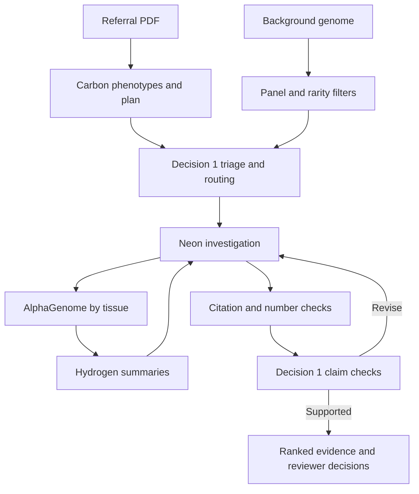

# GeneSleuth

An AI detective that helps geneticists find the hidden cause of unsolved genetic disease.

A child with epileptic encephalopathy had two rounds of blood RNA sequencing with ambiguous results. A deep intronic DNM1 variant affected an exon used in brain-specific transcripts. AlphaGenome predicted an effect in glutamatergic neurons and little corresponding signal in venous blood. Splice predictors can flag a variant. The tissue comparison helps explain why the blood tests were inconclusive. This published case motivates GeneSleuth and is excluded from the evidence for generalization. [AlphaGenome Atlas paper, Fig. 3](https://storage.googleapis.com/deepmind-media/DeepMind.com/Blog/alphagenome-atlas-a-predictive-map-of-every-possible-dna-letter-change-in-the-human-genome/alphagenome-atlas.pdf)

## The problem

Many families remain without a diagnosis after genetic testing. Protein-coding sequence accounts for roughly 2% of the genome, and the remaining sequence includes variants that can alter splicing and regulation. Finding a relevant variant takes more than looking for the largest predicted change. The candidate has to fit the patient's symptoms, the gene, and the tissue where the effect matters. [Genome Sequencing for Diagnosing Rare Diseases](https://doi.org/10.1056/NEJMoa2314761) · [AlphaGenome overview](https://deepmind.google/blog/alphagenome-ai-for-better-understanding-the-genome/)

## Built today at the Gemini 4 NYC Hackathon (Nov 21, 2026)

The Nov 19 research briefs were written before the event. Project code is written during the event. The build is organized into the data and benchmark, investigator and claim checker, and live demo and review workflow. See the [design](Design.md) for boundaries and [B2 status](STATUS_B2.md) for current verification.

## How it works



| Component | Job |
| --- | --- |
| Decision 1 | Batches triage and tissue routing, then checks claims against their cited evidence. |
| Gemini 4 Neon | Investigates, chooses variant–tissue pairs, ranks candidates, and revises rejected claims. |
| Gemini 4 Carbon | Reads the referral PDF, extracts HPO phenotypes, and writes a hypothesis plan. |
| Gemini 4 Hydrogen | Summarizes AlphaGenome outputs in parallel worker calls. |
| Gemini Managed Agents | Provides the hosted sandbox when enabled and verified. The demo runtime comes from the active investigation trace. |
| AlphaGenome | Atlas (AG1) supplies precomputed AVI scores. Live calls supply tissue-specific effects and reference-versus-alternate tracks. |

## Isn't this just one AI reading AlphaGenome's output?

AlphaGenome scores a supplied variant–tissue pair. GeneSleuth chooses which pairs to test across the candidate list under a call budget. Tissue choice changes what the model can see. The ranking also uses phenotype fit, frequency, and variant context. A claim checker verifies the resulting statements against cited tool calls and exposes rejections for review. The benchmark tests each addition against simpler approaches.

## Evidence

The benchmark design places public ClinVar variants into a public 1000 Genomes background and describes the phenotype in a synthetic referral. The case builder keeps a separate answer key and disables ClinVar lookup during investigation. Intended arms are AlphaGenome Atlas (AG1) AVI, fixed-brain AlphaGenome, Gemini without tools, and the full system, with a fixed recipe when available. Report hit@1, hit@5, and hit@10 with 95% binomial intervals. [Benchmark methodology and results](docs/BENCHMARK.md)

Measured test-set results and the chart are pending integration. The published DNM1 story is excluded from proof because it may be familiar to the model. MFSD8 c.999-556C>G is a recent published holdout candidate. Its eligibility depends on the confirmed coordinate and cutoff checks. The PLA2G6 c.2034+355G>A preprint illustrates a filter failure mode. The allele can be relatively common in one ancestry group and was implicated alongside a second allele, so a strict rarity filter can discard it. [MFSD8 report](https://doi.org/10.3389/fgene.2026.1980180) · [PLA2G6 preprint](https://doi.org/10.64898/2026.06.10.26355004)

## Run the demo

From the project root, with the data and investigator modules present:

```sh
python3.11 -m venv .venv
source .venv/bin/activate
python -m pip install -r requirements.txt
test -f .env || cp .env.example .env
```

Set `GEMINI_API_KEY`, `ALPHA_GENOME_API_KEY`, and an absolute shared `GENESLEUTH_DATA_DIR` in `.env`. Set the tissue IDs to the values confirmed in the [probe report](probes/B/REPORT.md). Then run:

```sh
python scripts/data_setup.py
python -m scripts.demo_prewarm
python -m scripts.demo_check
python -m genesleuth.server.app
```

Visit [GeneSleuth locally](http://127.0.0.1:8000). Pick a case or use Random, open the referral, and click Investigate. After the shortlist arrives, inspect the citations, reveal the hidden variant, or review and export the evidence. The prewarm step populates caches from background suspects only. The planted variant's live evidence is computed during the run.

## Data sources and terms

| Source | Use and terms |
| --- | --- |
| 1000 Genomes / IGSR | Public background genome. Credit the source collection and follow its reuse policy. [IGSR data and attribution](https://www.internationalgenome.org/data/) |
| ClinVar | Public variant labels for constructing cases and scoring the benchmark. [ClinVar use and attribution](https://www.ncbi.nlm.nih.gov/clinvar/docs/maintenance_use/) |
| gnomAD | Population frequencies. [gnomAD terms](https://gnomad.broadinstitute.org/terms) |
| PanelApp, MANE, and HPO | Panel genes, reference transcript annotation, and phenotype terms. Exact releases, terms, and bundled subsets are in the [data inventory](docs/DATA_SOURCES.md). |
| AlphaGenome and AlphaGenome Atlas | API outputs and Atlas scores are licensed for non-commercial research use and may not be used for clinical decisions. [AlphaGenome usage terms](https://google-deepmind-alphagenome.readthedocs-hosted.com/faqs.html#what-terms-of-use-apply-and-is-commercial-access-available) |

## Limitations

A candidate must survive the panel and frequency filters to be ranked. A synthetic referral can be cleaner than a real referral, and a planted single variant does not capture every inheritance pattern. Tissue models predict molecular effects with uneven tissue coverage. Claim verification tests consistency with the available evidence. Model outages, quota, and latency can limit how many candidates are scored.

## Team

Built at the Gemini 4 NYC Hackathon. Team and repository credits are listed in the submission.
