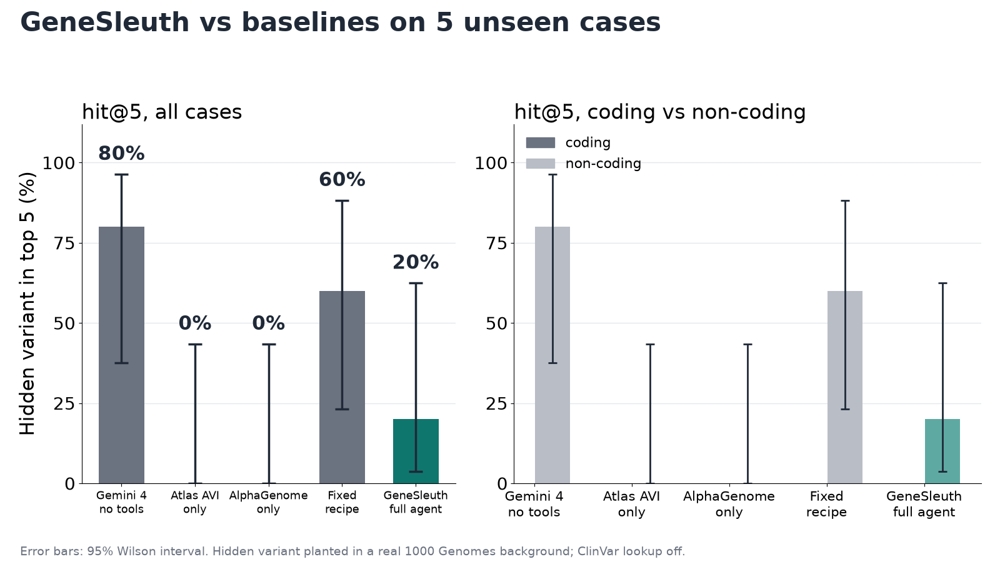

> **Stand-ins used:** atlas_no_scores(Atlas returned no AVI for any suspect: AlphaGenome Atlas metadata did not expose an AVI scorer; effect term = 0). Numbers for the affected arms are not final.

# Benchmark report: dev

5 cases; 5 case(s) have results in every mode. Hit rates show `% (hits/n) [95% Wilson interval]`. With n this small the intervals are wide; read the interval, not the point estimate. Errored runs count as misses.

## Headline

| Mode | n | hit@1 | hit@5 | hit@10 | MRR@10 | median rank | filter recall |
|---|---|---|---|---|---|---|---|
| Gemini 4, no tools | 5 | 80% (4/5) [38-96] | 80% (4/5) [38-96] | 80% (4/5) [38-96] | 0.80 | 1 | 100% (5/5) [57-100] |
| Atlas AVI only | 5 | 0% (0/5) [0-43] | 0% (0/5) [0-43] | 0% (0/5) [0-43] | 0.00 | 11+ | 100% (5/5) [57-100] |
| AlphaGenome only (brain) | 5 | 0% (0/5) [0-43] | 0% (0/5) [0-43] | 0% (0/5) [0-43] | 0.00 | 11+ | 100% (5/5) [57-100] |
| Fixed recipe (no LLM) | 5 | 60% (3/5) [23-88] | 60% (3/5) [23-88] | 80% (4/5) [38-96] | 0.62 | 1 | 100% (5/5) [57-100] |
| GeneSleuth (full agent) | 5 | 20% (1/5) [4-62] | 20% (1/5) [4-62] | 20% (1/5) [4-62] | 0.20 | 11+ | 100% (5/5) [57-100] |

Rank 11+ or missing counts as a miss. MRR is MRR@10. Median rank treats a miss as 11 (`+` = at least that).

## Resources

| Mode | median AlphaGenome calls | median tool calls | median time (s) | claims checked / rejected | errors | median cost / case (USD) |
|---|---|---|---|---|---|---|
| Gemini 4, no tools | 0 | 0 | 77.0 | 0 / 0 | 1 | 0.13 |
| Atlas AVI only | 0 | 0 | 21.4 | 0 / 0 | 5 | n/a |
| AlphaGenome only (brain) | 282 | 0 | 96.7 | 0 / 0 | 0 | n/a |
| Fixed recipe (no LLM) | 0 | 2 | 0.9 | 0 / 0 | 0 | n/a |
| GeneSleuth (full agent) | 0 | 0 | 148.3 | 25 / 6 | 4 | n/a |

Cost is read from `calls.jsonl` (Gemini calls only; AlphaGenome calls are not billed per call here). `~` = attributed by time window, so approximate.

## Breakdowns (hit@5)

#### Region type (coding vs non-coding)

| Mode | non-coding hit@5 |
|---|---|
| Gemini 4, no tools | 80% (4/5) [38-96] |
| Atlas AVI only | 0% (0/5) [0-43] |
| AlphaGenome only (brain) | 0% (0/5) [0-43] |
| Fixed recipe (no LLM) | 60% (3/5) [23-88] |
| GeneSleuth (full agent) | 20% (1/5) [4-62] |

#### Letter type (clean vs scanned)

| Mode | scanned hit@5 |
|---|---|
| Gemini 4, no tools | 80% (4/5) [38-96] |
| Atlas AVI only | 0% (0/5) [0-43] |
| AlphaGenome only (brain) | 0% (0/5) [0-43] |
| Fixed recipe (no LLM) | 60% (3/5) [23-88] |
| GeneSleuth (full agent) | 20% (1/5) [4-62] |

## Full-agent failure categories

| category | count |
|---|---|
| error | 4 |

Details in `failures.md`.

## Leakage controls

_No leakage-control results yet._

## Named cases (not pooled)

_No named-case runs yet (DNM1, MFSD8, PLA2G6 are reported separately and never pooled into TEST)._
