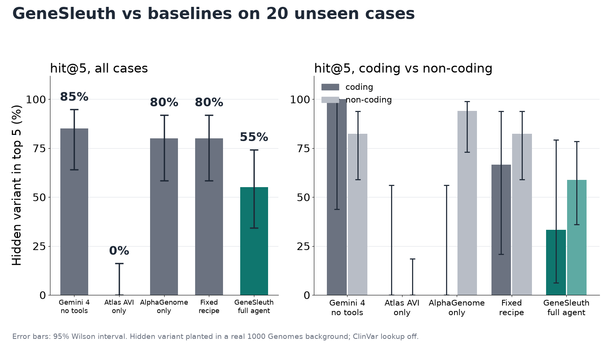

> **Stand-ins used:** atlas_no_scores(Atlas returned no AVI for any suspect: AlphaGenome Atlas metadata did not expose an AVI scorer; effect term = 0). Numbers for the affected arms are not final.

# Benchmark report: test

20 cases; 20 case(s) have results in every mode. Hit rates show `% (hits/n) [95% Wilson interval]`. With n this small the intervals are wide; read the interval, not the point estimate. Errored runs count as misses.

## Headline

| Mode | n | hit@1 | hit@5 | hit@10 | MRR@10 | median rank | filter recall |
|---|---|---|---|---|---|---|---|
| Gemini 4, no tools | 20 | 85% (17/20) [64-95] | 85% (17/20) [64-95] | 85% (17/20) [64-95] | 0.85 | 1 | 100% (20/20) [84-100] |
| Atlas AVI only | 20 | 0% (0/20) [0-16] | 0% (0/20) [0-16] | 0% (0/20) [0-16] | 0.00 | 11+ | 100% (20/20) [84-100] |
| AlphaGenome only (brain) | 20 | 80% (16/20) [58-92] | 80% (16/20) [58-92] | 85% (17/20) [64-95] | 0.81 | 1 | 100% (20/20) [84-100] |
| Fixed recipe (no LLM) | 20 | 55% (11/20) [34-74] | 80% (16/20) [58-92] | 90% (18/20) [70-97] | 0.66 | 1 | 100% (20/20) [84-100] |
| GeneSleuth (full agent) | 20 | 50% (10/20) [30-70] | 55% (11/20) [34-74] | 55% (11/20) [34-74] | 0.51 | 3 | 100% (20/20) [84-100] |

Rank 11+ or missing counts as a miss. MRR is MRR@10. Median rank treats a miss as 11 (`+` = at least that).

## Resources

| Mode | median AlphaGenome calls | median tool calls | median time (s) | claims checked / rejected | errors | median cost / case (USD) |
|---|---|---|---|---|---|---|
| Gemini 4, no tools | 0 | 0 | 49.0 | 0 / 0 | 3 | 0.13 |
| Atlas AVI only | 0 | 0 | 3.9 | 0 / 0 | 20 | n/a |
| AlphaGenome only (brain) | 282 | 0 | 6.3 | 0 / 0 | 0 | n/a |
| Fixed recipe (no LLM) | 0 | 2 | 0.9 | 0 / 0 | 0 | n/a |
| GeneSleuth (full agent) | 0 | 42.5 | 150.5 | 316 / 82 | 9 | 0.36 |

Cost is read from `calls.jsonl` (Gemini calls only; AlphaGenome calls are not billed per call here). `~` = attributed by time window, so approximate.

## Breakdowns (hit@5)

#### Region type (coding vs non-coding)

| Mode | coding hit@5 | non-coding hit@5 |
|---|---|---|
| Gemini 4, no tools | 100% (3/3) [44-100] | 82% (14/17) [59-94] |
| Atlas AVI only | 0% (0/3) [0-56] | 0% (0/17) [0-18] |
| AlphaGenome only (brain) | 0% (0/3) [0-56] | 94% (16/17) [73-99] |
| Fixed recipe (no LLM) | 67% (2/3) [21-94] | 82% (14/17) [59-94] |
| GeneSleuth (full agent) | 33% (1/3) [6-79] | 59% (10/17) [36-78] |

#### Letter type (clean vs scanned)

| Mode | clean hit@5 | scanned hit@5 |
|---|---|---|
| Gemini 4, no tools | 83% (10/12) [55-95] | 88% (7/8) [53-98] |
| Atlas AVI only | 0% (0/12) [0-24] | 0% (0/8) [0-32] |
| AlphaGenome only (brain) | 83% (10/12) [55-95] | 75% (6/8) [41-93] |
| Fixed recipe (no LLM) | 83% (10/12) [55-95] | 75% (6/8) [41-93] |
| GeneSleuth (full agent) | 25% (3/12) [9-53] | 100% (8/8) [68-100] |

## Full-agent failure categories

| category | count |
|---|---|
| error | 9 |

Details in `failures.md`.

## Leakage controls

_No leakage-control results yet._

## Named cases (not pooled)

_No named-case runs yet (DNM1, MFSD8, PLA2G6 are reported separately and never pooled into TEST)._
